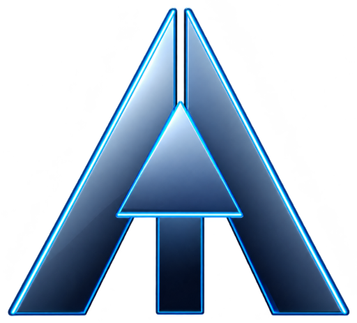
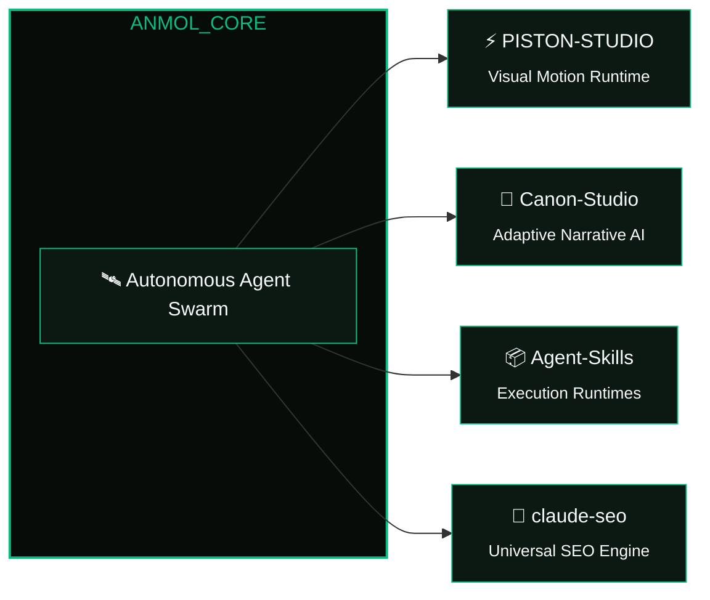

<div align="center">

  

  <h1 align="center" style="font-weight: 800; font-size: 2.2rem; margin-top: 8px; margin-bottom: 4px; letter-spacing: -0.02em;">
    ANMOL KUMAR
  </h1>

  <p align="center" style="color: #94a3b8; font-size: 1rem;">
    <strong>Autonomous AI Engineer • Full-Stack Systems • Motion Architect</strong>
  </p>

  <p align="center">
    <a href="https://portfolio-anmol.pages.dev"></a>
    &nbsp;
    <a href="https://github.com/Anmolop97?tab=repositories"></a>
    &nbsp;
    <a href="mailto:anmolkumar2762@gmail.com"></a>
  </p>

</div>

```text
┌─── ANMOL_CORE :: SYSTEM TELEMETRY v2.6 ──────────────────────────────────────┐
│  STATUS: ONLINE [●]  │  NODE: IND-NORTH  │  LATENCY: 12ms  │  MODE: MATRIX-GREEN│
└──────────────────────────────────────────────────────────────────────────────┘
```

### 🛰️ Subsystems & Agent Swarm



### ⚙️ Telemetry Matrix

```ini
[SYSTEM_KERNEL]
Host        = B.Tech CSE (Autonomous Subsystem)
Directive   = Building resilient full-stack systems & multi-agent developer tooling
Environment = Linux / x86_64 • Cloudflare Workers • Node/Bun Runtime

[NEURAL_STACK]
Languages   = TypeScript (98%) • JavaScript (95%) • Python (90%) • C++ (82%)
Frameworks  = React 19 • Next.js 15 • Tailwind CSS • Vite • Framer Motion
AI_Protocol = Antigravity Agent • Claude Code • Model Context Protocol (MCP)

[ACTIVE_PROCESSES]
PID 101  🟢 RUNNING   Agent-Skills     :: Automated workflows & AI toolings
PID 102  ⚡ ACTIVE    PISTON-STUDIO    :: Web-based visual motion studio
PID 103  🧠 STANDBY   Canon-Studio     :: Narrative continuity & state graphs
PID 104  🚀 DEPLOYED  claude-seo       :: Universal SEO engine (26 skills + 19 agents)
PID 105  🐾 IDLE      myCat            :: Desktop companion (QT overlay)
```

---

### 📊 Realtime Metrics

<div align="center">
  
  
</div>

<div align="center">
  <sub><i>"The best way to predict the future is to build it."</i> • Anmol Kumar</sub>
</div>
