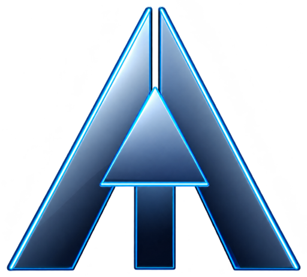

<div align="center">

  

  <h1 align="center" style="font-weight: 800; font-size: 2.4rem; margin-top: 10px; margin-bottom: 5px;">
    ⚡ ANMOL KUMAR
  </h1>

  <p align="center">
    <strong>Creative Software Engineer • Full-Stack Developer • Agentic AI Enthusiast</strong>
  </p>

  <p align="center">
    <a href="https://github.com/Anmolop97"></a>
    <a href="https://github.com/Anmolop97/Agent-Skills"></a>
  </p>

  

</div>

---

### 💻 `sys.info()`

```bash
╭────────────────────────────────────────────────────────────────────────╮
│  anmol@workstation:~$ neofetch                                         │
├────────────────────────────────────────────────────────────────────────┤
│  OS          : Linux / Windows 11 Pro                                  │
│  Role        : Computer Science & Creative Engineering                 │
│  Focus       : High-Performance Web Apps, Agentic AI, UI/UX Systems    │
│  Philosophy  : Understand deep, build clean, break, fix, iterate       │
│  Superpower  : Turning raw ideas into polished interactive software    │
│  Current Obsession : Agent Skills, WebGL, React 19 & Tailwind v4       │
╰────────────────────────────────────────────────────────────────────────╯
```

---

### 🚀 Featured Highlights

<table align="center" width="100%">
  <tr>
    <td width="50%" valign="top">
      <h3 align="center">⚡ <a href="https://github.com/Anmolop97/Agent-Skills">Agent-Skills</a></h3>
      <p align="center">
        
        
      </p>
      <p align="center">
        The universal skill vault for AI coding assistants (Antigravity, Claude Code, Cursor, MCP). Features 30+ automated workflows, testing pipelines, and deterministic quality gates.
      </p>
    </td>
    <td width="50%" valign="top">
      <h3 align="center">🔥 <a href="https://github.com/Anmolop97/TheHellspires">TheHellspires</a></h3>
      <p align="center">
        
        
      </p>
      <p align="center">
        A high-velocity modern web application engineered with Vite, Tailwind CSS v4, Framer Motion, and fluid smooth-scrolling interactions.
      </p>
    </td>
  </tr>
</table>

---

### 🛠️ Tech Stack & Engineering Arsenal

<div align="center">

  #### 🌐 Languages & Core
  <p>
    
    
    
    
    
    
  </p>

  #### ⚛️ Frameworks, UI & Libraries
  <p>
    
    
    
    
    
    
  </p>

  #### 🤖 AI, Tooling & DevOps
  <p>
    
    
    
    
    
    
  </p>

</div>

---

### 📊 GitHub Activity & Metrics

<div align="center">
  
  
</div>

<div align="center" style="margin-top: 15px;">
  
</div>

---

<div align="center">
  <sub>⚡ <i>"The best way to predict the future is to build it."</i> • Engineered with passion by Anmol Kumar</sub>
</div>
